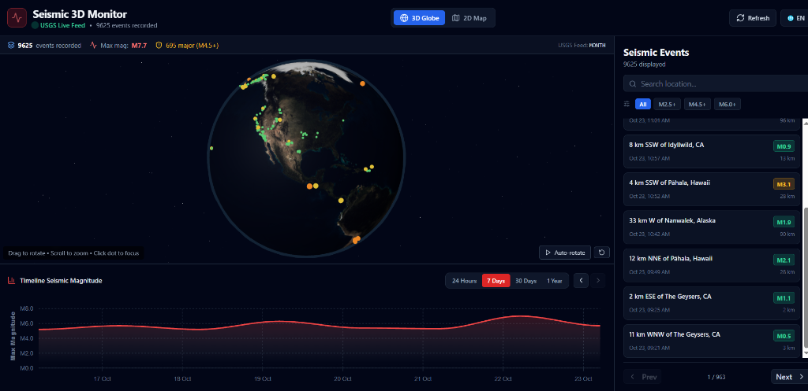

# 🌍 Realtime 3D Earthquake Monitor

[](https://realtime-3d-earthquake-monitor.vercel.app/)
[](https://nextjs.org/)
[](https://react.dev/)
[](https://threejs.org/)
[](https://www.typescriptlang.org/)
[](https://tailwindcss.com/)
[](https://opensource.org/licenses/MIT)

> An interactive, real-time 3D global earthquake visualizer and seismic monitoring dashboard. Combines hardware-accelerated WebGL with Three.js, a 2D equirectangular command map, temporal magnitude analytics, and live feeds from the **USGS (United States Geological Survey)**.

🔗 **Live Deployment:** [https://realtime-3d-earthquake-monitor.vercel.app/](https://realtime-3d-earthquake-monitor.vercel.app/)

---

## 📸 Preview



---

## ✨ Features

- **🌐 Interactive 3D WebGL Globe**:
  - Rendered with **Three.js** and **React Three Fiber (v9)** on **React 19**.
  - Photorealistic Earth texture with cyan atmospheric glow and deep-space starfield.
  - Earthquake markers physically anchored to exact geographic coordinates:
    - 🟢 **M < 2.5**: Minor / Micro
    - 🟡 **M 2.5 - 4.5**: Light / Moderate
    - 🟠 **M 4.5 - 6.0**: Strong
    - 🔴 **M > 6.0**: Severe / Major (with 3D animated pulsing beacon ring).
  - Smooth orbit controls with intuitive camera fly-to upon selecting any seismic event.
  - Optional smooth camera auto-rotation with single-click play/pause toggle.

- **🗺️ 2D Equirectangular Command Map**:
  - Seamless one-click switcher between **3D Globe** and **2D World Map**.
  - High-performance HTML5 Canvas projection with true 2:1 geographic aspect ratio.
  - Full coordinate reference lines (Latitude, Longitude, Equator, Prime Meridian).
  - Built-in **Zoom (`+` / `-`)**, **Pan & Drag**, and **Reset (`↺`)** controls.

- **📊 Timeline Seismic Analytics**:
  - Powered by **ApexCharts** with responsive dark theme styling.
  - Dynamic time grouping: 24 Hours, 7 Days, 30 Days, and 1 Year queries.
  - Period-by-period browsing with forward/backward navigation controls.

- **🔍 Live Search & Filter Engine**:
  - Real-time location search (e.g., *"California"*, *"Japan"*, *"Chile"*, *"Alaska"*).
  - Quick filter chips by minimum magnitude (All, M2.5+, M4.5+, M6.0+).
  - Interactive event list with magnitude badges, timestamp, and focal depth.

- **🌐 Instant Bilingual Toggle (EN / ES)**:
  - Switch between English and Spanish on the fly without page reloads.

- **⚡ Live USGS Open Data Integration**:
  - Direct connection to official USGS GeoJSON feeds without requiring private API keys.
  - Automated polling every 5 minutes with real-time status beacon.

---

## 🛠️ Tech Stack

| Layer | Technology |
| :--- | :--- |
| **Framework** | [Next.js 15](https://nextjs.org/) (App Router, Server Components & Client Hydration) |
| **Frontend Library** | [React 19](https://react.dev/) |
| **3D Graphics & WebGL** | [Three.js](https://threejs.org/), [@react-three/fiber](https://docs.pmnd.rs/react-three-fiber), [@react-three/drei](https://github.com/pmndrs/drei) |
| **Styling & Design System** | [Tailwind CSS](https://tailwindcss.com/), Radix UI / Shadcn UI |
| **Data Visualization** | [ApexCharts](https://apexcharts.com/) / `react-apexcharts`, [Recharts](https://recharts.org/) |
| **Data Provider** | [USGS Earthquake Hazards Program](https://earthquake.usgs.gov/) |
| **Icons** | [Lucide React](https://lucide.dev/) |
| **Hosting** | [Vercel](https://vercel.com/) |

---

## 📁 Project Structure

```plaintext
realtime-3-d-react-app/
├── app/
│   ├── globals.css              # Tailwind CSS and Shadcn dark/light design tokens
│   ├── layout.tsx               # SEO metadata, OpenGraph tags, Inter font
│   └── page.tsx                 # Main dashboard and 3D/2D viewport switcher
├── components/
│   ├── ui/                      # Accessible UI components (Shadcn/Radix)
│   ├── earthquake-context.tsx   # Global state, USGS API client and filtering
│   ├── earthquake-globe.tsx     # 3D Globe with Three.js, markers and atmosphere
│   ├── earthquake-map-2d.tsx    # 2D Canvas equirectangular world map
│   ├── earthquake-chart.tsx     # ApexCharts chronological magnitude chart
│   ├── earthquake-list.tsx      # Paginated event list with search & filters
│   ├── earth.tsx                # Standalone reusable 3D Earth mesh
│   └── header.tsx               # Navbar, view toggle, and live feed status
├── public/
│   ├── assets/3d/               # High-resolution Earth texture map
│   ├── preview.png              # Readme visual preview screenshot
│   └── icons & favicons         # Application icons and manifest
├── .env.example                 # Environment variables template (no secrets needed)
├── .gitignore                   # Strict exclusions (node_modules, .next, .env)
├── next.config.mjs              # Next.js production configuration
├── package.json                 # Dependencies and execution scripts
├── tailwind.config.ts           # Tailwind configuration
└── tsconfig.json                # Strict TypeScript configuration
```

---

## 🚀 Quickstart & Local Setup

### 1. Prerequisites
- **Node.js** v18 or higher (v20+ or v24 recommended).
- **npm**, **pnpm**, or **yarn**.

### 2. Clone and Install Dependencies
```bash
# Clone the repository
git clone https://github.com/YOUR-USERNAME/realtime-3d-earthquake-monitor.git

# Navigate into project directory
cd realtime-3d-earthquake-monitor

# Install dependencies
npm install
```

### 3. Run Development Server
```bash
npm run dev
```
Open [http://localhost:3000](http://localhost:3000) in your browser to view the application.

### 4. Build for Production
```bash
npm run build
npm run start
```

---

## 🔒 Security & Privacy

- **No Private API Keys Required**: This project connects directly to the public open data API provided by the **USGS**.
- **Safeguarded `.gitignore`**: Pre-configured rules ensure local configuration files (`.env`, `.env.local`), build artifacts (`.next/`, `build/`), and dependencies (`node_modules/`) are never pushed to GitHub.
- If you wish to extend the project with optional third-party integrations (such as Mapbox or custom analytics), use `.env.example` as a template for your `.env.local` file.

---

## 🌐 Deploy to Vercel

The easiest way to deploy this application is using the [Vercel Platform](https://vercel.com):

1. Push your code to your GitHub repository.
2. Sign in to [Vercel](https://vercel.com/) and click **"Add New Project"**.
3. Import your GitHub repository.
4. Click **"Deploy"**. Vercel will automatically detect Next.js 15 and launch your site in seconds.

---

## 📄 License & Attribution

- **Data Attribution**: Seismic event data provided by the [USGS Earthquake Hazards Program](https://earthquake.usgs.gov/).
- **License**: This project is open-source and licensed under the [MIT License](LICENSE).
